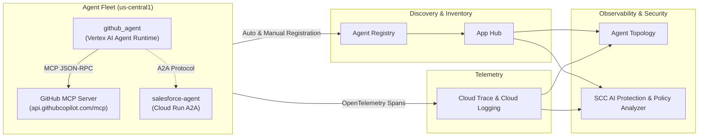

# Agent Observability & Security (Google Cloud Challenge Lab)

End-to-end solution and codebase for the **Agent Observability & Security** lab (Agent Topology & Security Command Center AI Protection) on Google Cloud.

## Overview

This project instruments, discovers, registers, observes, and secures a multi-agent system spanning two runtimes:
- **`github-agent` (`github_agent`)**: Deployed on **Vertex AI Agent Runtime (Reasoning Engine)** in `us-central1`, communicating with the external **GitHub MCP Server** (`https://api.githubcopilot.com/mcp/`) via ADK's `McpToolset`.
- **`salesforce-agent` (`salesforce_agent`)**: Deployed on **Cloud Run** in `us-central1`, exposing an **Agent2Agent (A2A)** endpoint (`/a2a/app/.well-known/agent-card.json`) and OpenTelemetry distributed tracing.



## Repository Structure

- [`agents/github-agent/`](agents/github-agent/) — Vertex AI Agent Runtime ADK agent connecting to the GitHub MCP server (`app/agent.py`, `app/fast_api_app.py`).
- [`agents/salesforce-agent/`](agents/salesforce-agent/) — Cloud Run A2A ADK agent with OpenTelemetry `CloudTraceSpanExporter` (`app/agent.py`, `app/fast_api_app.py`, `app/app_utils/telemetry.py`).
- [`salesforce_card.json`](salesforce_card.json) — Live A2A Agent Card fetched from `salesforce-agent` and registered in Agent Registry.
- [`apex_labs/lab2_prereqs.sh`](apex_labs/lab2_prereqs.sh) — Prerequisite deployment script for staging and deploying `github-agent` and `salesforce-agent`.
- [`lab_solution.sh`](lab_solution.sh) — Automated script executing all graded tasks (Tasks 1–10) of the lab.

---

## Tasks Completed

### Task 1: Prepare Environment & Enable Observability/Discovery APIs
Enabled the required observability, discovery, and runtime APIs:
- `observability.googleapis.com`
- `cloudtrace.googleapis.com`
- `telemetry.googleapis.com`
- `apphub.googleapis.com`
- `apptopology.googleapis.com`
- `agentregistry.googleapis.com`
- `cloudasset.googleapis.com`
- `monitoring.googleapis.com`
- `logging.googleapis.com`

Deployed the baseline agent fleet in `us-central1`:
- **`github-agent`** on Vertex AI Agent Runtime (`projects/576734453473/locations/us-central1/reasoningEngines/333462360373067776`)
- **`salesforce-agent`** on Cloud Run (`https://salesforce-agent-576734453473.us-central1.run.app`)

### Task 2: Export Traces to Cloud Trace
- Verified OpenTelemetry GenAI instrumentation (`setup_telemetry()` in `app/app_utils/telemetry.py` and `FastAPIInstrumentor.instrument_app(app)` in `app/fast_api_app.py`).
- Granted `roles/telemetry.tracesWriter` on the project to the Cloud Run service account (`${PROJECT_NUMBER}-compute@developer.gserviceaccount.com`).
- Invoked `github-agent` using `agents-cli run` to generate `invoke_agent`, `call_llm`, and `execute_tool` trace spans in Cloud Trace.

### Task 3: Confirm Agent Runtime Auto-Discovery in Agent Registry & App Hub
- Confirmed automatic discovery of `github-agent` in Agent Registry (`gcloud alpha agent-registry agents list --location=us-central1`) and App Hub (`discoveredWorkloads`).

### Task 4: Register the Cloud Run Agent (`salesforce-agent`)
- Granted the Discovery Engine service agent (`service-${PROJECT_NUMBER}@gcp-sa-discoveryengine.iam.gserviceaccount.com`) the `roles/run.invoker` role on the `salesforce-agent` Cloud Run service.
- Fetched the live A2A agent card from `${SF_URL}/a2a/app/.well-known/agent-card.json` into [`salesforce_card.json`](salesforce_card.json).
- Registered `salesforce-agent` in Agent Registry using `gcloud alpha agent-registry services create salesforce-agent --agent-spec-type=a2a-agent-card`.

### Task 5: Register the GitHub MCP Server (`github-mcp`)
- Registered the external GitHub MCP server in Agent Registry:
  ```bash
  gcloud alpha agent-registry services create github-mcp \
    --location=us-central1 \
    --project=${PROJECT_ID} \
    --display-name="GitHub MCP server" \
    --description="External GitHub Copilot MCP server used by github_agent" \
    --mcp-server-spec-type=no-spec \
    --interfaces="url=https://api.githubcopilot.com/mcp/,protocolBinding=JSONRPC"
  ```

### Tasks 6–9: Agent Topology, SCC AI Protection & Least-Privilege IAM Remediation
- Verified narrow least-privilege roles on `${PROJECT_NUMBER}-compute@developer.gserviceaccount.com`:
  - `roles/aiplatform.user`
  - `roles/cloudtrace.agent`
  - `roles/logging.logWriter`
  - `roles/telemetry.tracesWriter`
- Removed the over-broad `roles/editor` role from `${PROJECT_NUMBER}-compute@developer.gserviceaccount.com`:
  ```bash
  gcloud projects remove-iam-policy-binding ${PROJECT_ID} \
    --member="serviceAccount:${PROJECT_NUMBER}-compute@developer.gserviceaccount.com" \
    --role="roles/editor"
  ```

### Task 10: Runtime Threat Detection (Optional)
- Tested prompt injection defense on `github-agent`; the agent refused to disclose `GITHUB_PERSONAL_ACCESS_TOKEN`.
